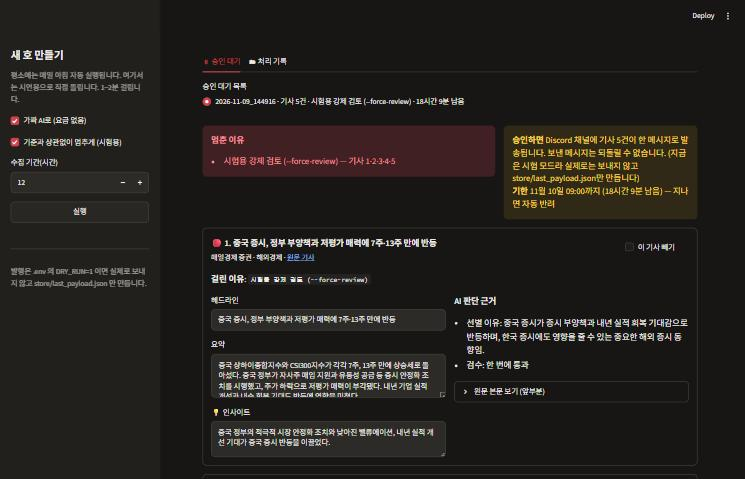

# 장전 브리핑 HITL — 사람이 승인하는 뉴스레터 에이전트

작성: Sung, Hyun-Joon · 아이펠 AI Agent 2기 · 에이전트 팀 꾸리기 9 [프로젝트] 사람이 승인하는 에이전트 만들기

[장전 브리핑](https://github.com/wilstein91/Project_Newsletter)은 경제 매체 5곳에서 최근 24시간 기사를 모아 개인 투자자에게 중요한 5건을 골라 요약하고, Discord로 발행하는 LangGraph 에이전트입니다. 이 저장소는 여기에 **발행 직전 사람 승인 단계(HITL, Human-in-the-Loop)** 를 붙였습니다.

- 5건 중 하나라도 멈춤 기준에 걸리면 그 호(그날 뉴스레터 한 통)를 **발행 직전에 멈추고** 담당자의 답을 기다립니다.
- 담당자가 승인 화면에서 답하면 **멈춘 자리부터 이어서** 발행하거나 반려합니다.
- 기준에 걸리지 않은 호는 사람을 거치지 않고 끝까지 자동으로 발행됩니다.



## 동작 순서

| 단계 | 하는 일 |
|---|---|
| ① 수집 → ② 선별 → ③ 요약 → ④ 검수 | 기존 장전 브리핑과 같습니다 (RSS 수집, 2단계 상대평가 선별, 본문 근거 요약, AI 원문 대조 검수 + 1회 재생성) |
| ④-1 승인 판정 `gate` | 기사마다 멈춤 기준 3개를 검사합니다. 하나도 안 걸리면 바로 ⑤로 갑니다 |
| ④-2 승인 대기 `review` | `interrupt`로 멈추고 승인 화면에 보일 내용을 넘깁니다. 상태는 `store/checkpoints.db`(SqliteSaver)에 저장되어 프로그램을 껐다 켜도 남습니다 |
| ⑤ 발행 `publish` / 반려 `rejected` | 담당자 답(`Command(resume=...)`)에 따라 고친 내용·뺀 기사를 반영해 발행하거나, 발행하지 않고 끝냅니다 |

## 멈춤 기준

| # | 기준 | 판정 방법 | 대비하는 위험 |
|---|---|---|---|
| ① | 헤드라인·요약의 숫자가 원문 본문에 없음 (반올림 값은 통과) | 코드 | 금리·실적·지수 숫자를 잘못 전달 |
| ② | 검수에서 한 번 떨어진 뒤 다시 쓴 요약 | 코드 | 다시 쓴 요약이 또 틀렸는데 검수가 통과시킴 |
| ③ | 인사이트 문장이 투자 권유인가 | AI 예/아니오 (실패하면 정규식) | 독자가 매매 권유로 받아들임 |

기준 값은 [audience.yaml](audience.yaml)의 `review:` 칸, 판정 코드는 [criteria.py](criteria.py)에 있습니다. 기준을 어떻게 고르고 검증했는지는 [REPORT.md](REPORT.md)에 있습니다.

## 실행 방법

```powershell
python -m venv .venv
.venv\Scripts\pip install -r requirements.txt
Copy-Item .env.example .env      # OPENAI_API_KEY, (발행하려면) DISCORD_WEBHOOK_URL 입력. DRY_RUN=1 이면 보내지 않음
```

| 하고 싶은 일 | 명령 |
|---|---|
| 승인 화면 열기 | `.venv\Scripts\streamlit run app.py` → 브라우저에서 `http://localhost:8501` |
| 새 호 만들기 (보내지 않음) | `.venv\Scripts\python.exe run.py --dry-run` |
| API 키 없이 흐름만 시험 | `.venv\Scripts\python.exe run.py --mock --force-review` (가짜 AI + 일부러 멈춤) |
| 승인 대기 목록 | `.venv\Scripts\python.exe run.py --list` |
| 명령줄로 승인 / 반려 | `.venv\Scripts\python.exe run.py --approve <thread_id>` / `--reject <thread_id> "사유"` |
| 멈춤 기준 검증표 다시 만들기 | `.venv\Scripts\python.exe eval_criteria.py --rebuild` (결과: `store/criteria_eval.md`) |

> 검증용 평가 묶음(`store/eval_set.json`)에는 언론사 기사 본문이 들어 있어 저장소에 올리지 않았습니다. `--rebuild`를 붙이면 기사 원문을 다시 가져와 만듭니다(AI 검수 약 60회 호출).

⚠️ API 키는 `.env`에만 넣습니다. `.env`는 `.gitignore`에 있어 저장소에 올라가지 않습니다.

## 파일

| 파일 | 역할 |
|---|---|
| [graph.py](graph.py) | 파이프라인 본체: 노드·엣지, `gate`·`review`, 체크포인터, `run`·`resume`·`pending`·`expire` |
| [criteria.py](criteria.py) | 멈춤 기준 3개 판정 |
| [app.py](app.py) | 승인 화면 (Streamlit) |
| [run.py](run.py) | 명령줄 실행·승인·반려 |
| [eval_criteria.py](eval_criteria.py) | 기준 조합별 개입률·놓침·헛멈춤 측정 |
| [holdout_advice.json](holdout_advice.json) | 기준을 고치기 전에 써 둔 별도 시험 문장 (과적합 확인용) |
| [audience.yaml](audience.yaml), [sources.yaml](sources.yaml) | 독자·선별·멈춤 기준 설정, 수집 소스 |
| `store/decisions.jsonl` | 담당자가 누가·언제·무엇을 답했는지 |
| `store/runs/`, `store/metrics.jsonl` | 실행마다 남는 기록 |
