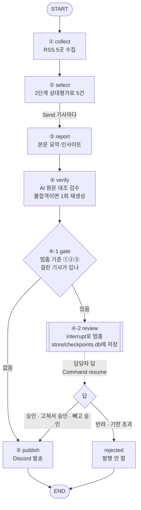
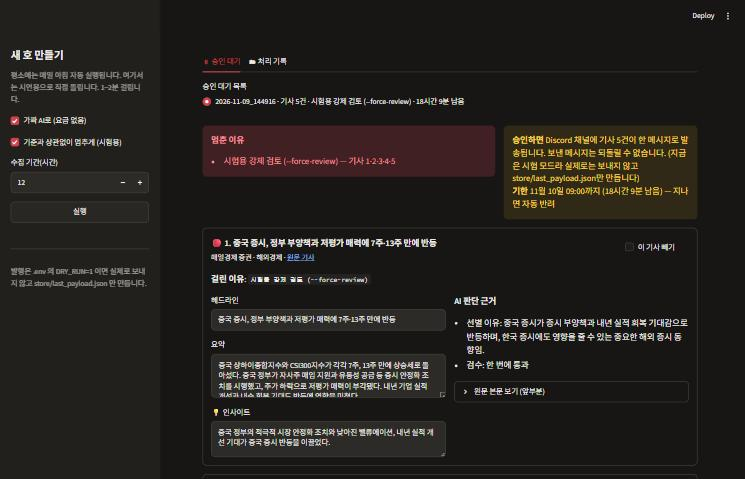
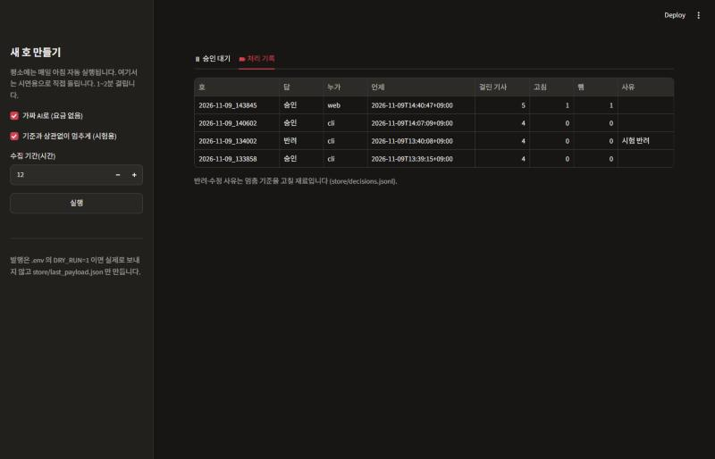

# REPORT — 사람이 승인하는 장전 브리핑

작성: Sung, Hyun-Joon · 아이펠 AI Agent 2기 · 에이전트 팀 꾸리기 9 [프로젝트]

## 1. 주제와 고른 이유

**자동화한 업무**: 매일 아침 경제 매체 5곳의 기사를 모아 개인 투자자용 소식 5건을 골라 요약·인사이트를 붙여 Discord 채널로 보내는 뉴스레터([장전 브리핑](https://github.com/wilstein91/Project_Newsletter), 3번 노드 과제)에 사람 승인 단계를 붙였다.

**결과가 바깥으로 나가는 단계**: ⑤ 발행 하나다. Discord로 보낸 메시지는 구독자가 바로 읽기 때문에 되돌릴 수 없다. 앞 단계(수집·선별·요약·검수)는 틀려도 다시 돌리면 된다.

**고른 이유**
- 경제 뉴스는 숫자 하나, 방향 하나(인상↔인하)만 틀려도 독자의 투자 판단을 그르친다. 기존 파이프라인에는 AI 검수가 있지만, AI 검수 역시 100%가 아니다.
- 독자가 개인 투자자라서 인사이트 문장이 "사라·팔아라"처럼 읽히면 투자 권유 책임 문제가 생긴다. 이건 숫자와 종류가 다른 위험이다.
- 매일 5건을 모두 사람이 보면 자동화한 의미가 없다. 그래서 **위험한 날만** 멈추게 해야 한다. HITL이 맞는 문제다.

## 2. 파이프라인 구조도

**State(상태)에 이번에 더한 칸**

| 칸 | 누가 채우나 | 쓰임 |
|---|---|---|
| `thread` | 실행 시작 시 | 이 호의 `thread_id` (실행 시각). 대기 건이 여러 개여도 섞이지 않게 구분 |
| `created_at` | 실행 시작 시 | 대기 기한 계산 |
| `flags` | `gate` | 기사 번호 → 멈춘 이유 목록 |
| `decision` | `review` (재개 후) | 담당자의 답: 승인/반려, 고친 내용, 뺀 기사, 사유 |
| `verified` | `verify` → `review`가 덮어씀 | 담당자가 뺀 기사는 빠지고 고친 문구가 반영된 최종 발행 목록 |

**멈춤과 재개**
- `review` 노드 안의 `interrupt({...})`에서 실행이 멈춘다. 괄호 안의 값(멈춘 이유, 승인하면 일어나는 일, 기사별 요약·원문·판단 근거)이 그대로 승인 화면 내용이 된다.
- 체크포인터는 `SqliteSaver`(파일 하나)다. 담당자가 몇 시간 뒤에 답해도, 그 사이 프로그램을 껐다 켜도 이어서 처리된다. 실제로 "멈춘 실행"과 "승인한 실행"을 다른 프로세스로 돌려 확인했다.
- 재개하면 `review`가 첫 줄부터 다시 실행되므로, `interrupt` 앞에는 알림·발송 같은 바깥 동작을 두지 않았다.
- 대기 목록은 체크포인트의 '다음 단계'가 `review`인 호만 골라 만든다. 이미 처리된 호나 없는 호를 다시 승인하려 하면 막는다. 실제로 이 사고를 시험 중에 겪고 막는 코드를 넣었다.

## 3. 승인 기준과 그 이유

| # | 기준 (계산 가능한 형태) | 대비하는 위험 | 판정 |
|---|---|---|---|
| ① | 헤드라인·요약에 나온 숫자 중 **원문 본문에 없는 숫자가 1개 이상** (원문 숫자를 반올림한 값은 있는 것으로 봄) | 금리·실적·지수 숫자 오기 | 코드 |
| ② | 검수에서 **1차 불합격 후 다시 쓴 요약** (`regen ≥ 1`) | 이미 한 번 틀린 기사. 다시 쓴 요약이 또 틀렸는데 검수가 통과시킬 수 있음 | 코드 |
| ③ | 인사이트 문장이 **투자 권유인가** — AI가 예/아니오로 판정, AI 호출 실패 시 정규식 | 독자가 매매 권유로 받아들임 (숫자와 다른 종류의 위험) | AI 예/아니오 |

5건 중 **하나라도** 걸리면 그 호 전체를 멈춘다. Discord에는 한 번에 한 메시지로 나가기 때문에 기사마다 따로 멈추지 않았다.

**자동으로 처리되는 건과 그래도 괜찮은 이유**
- 자동 발행되는 호는 다섯 가지를 모두 통과한 기사만 있는 날이다.
  1. AI 검수를 한 번에 통과했다.
  2. 요약 속 숫자가 모두 원문에 있다.
  3. 인사이트가 권유가 아니다.
  4. 원문 본문이 600자 이상이다(기존 규칙).
  5. 한국어 비율·길이 검사도 통과했다(기존 규칙).
- 실제 발행 기사 원본 14건(3번 과제 기록)은 기준에 걸린 것이 0건이었다. 사람이 봐도 고칠 게 없는 날이 대부분이라는 뜻이다.
- 예: 2026-11-09 14:48 실행은 266건 수집 → 5건 → 검수 5/5 통과 → 기준 0건 → 자동 발행되었다.

**대기 건 운영 규칙**: 장전 브리핑은 장 시작(09:00) 뒤에는 쓸모가 없다. 그래서 만든 뒤 처음 맞는 09시까지 승인되지 않으면 자동 반려한다(`expire`, 승인 화면을 열거나 새 호를 만들 때 실행).

### 3-1. 기준을 어떻게 골랐나 — 검증 기록

**평가 묶음**: 3번 과제 때 실제 발행한 기사 14건으로 경우 5가지를 만들었다. 각 요약은 실제 파이프라인처럼 AI 검수에 먼저 넣고, 떨어지면 재작성(`regen=1`)으로 쳤다. 만드는 코드는 [eval_criteria.py](eval_criteria.py).

| 경우 | 만드는 법 | 정답(사람이 봐야 하나) | 건수 | AI 검수가 잡음 |
|---|---|---|---|---|
| 원본 | 실제 발행 요약 | 아니오 | 14 | 0 |
| 숫자 10배 | 금액·비율 하나를 10배 | 예 | 11 | 11 |
| 방향 뒤집기 | 상승↔하락, 인상↔인하 | 예 | 8 | 7 |
| 권유 문장 | 인사이트 끝에 권유 문장 추가 (말투 4가지) | 예 | 14 | 0 |
| 반올림 | 소수점 숫자를 "약 N"으로 | 아니오 | 7 | 0 |

**v1 → v2 → v3 (평가 묶음 54건, 사람이 봐야 하는 건 33건)**

| 기준 | 기사 개입률 | 놓침 | 헛멈춤 |
|---|---|---|---|
| 기준 없음 | 0% | 33 | 0 |
| ② 재작성만 | 33% | 15 | 0 |
| ① + ② + ③ **v1** (단순 단어 목록) | 61% | 7 | 7 |
| ① + ② + ③ **v2** (반올림 허용, 순매수·매수세 제외, 말투 패턴 추가) | 59% | 1 | 0 |
| ① + ② + ③ **v3** (③을 AI 판정으로) | 59% | 1 | 0 |
| 전부 멈춤 | 100% | 0 | 21 |

- **놓침과 개입률은 반대로 움직였다.** 전부 멈추면 놓침이 0이지만 헛멈춤이 21건이다.
- **종류가 다른 기준을 더하면 둘 다 줄었다.** ②만으로는 15건을 놓쳤는데, ③(권유)을 더하자 크게 줄었다.
- v1의 헛멈춤 7건은 원인이 두 가지였다. 하나는 "약 4%"처럼 반올림한 숫자를 "원문에 없는 숫자"로 본 것(6건)이다. 다른 하나는 "외국인 매수세" 같은 사실 보도를 권유로 본 것(1건)이다. v2에서 둘 다 고쳤다.
- 개입률 59%는 이 묶음에 일부러 틀린 요약을 많이 넣어서 나온 값이다. 실제 개입률은 원본 14건 기준 0%다.

**과적합 확인 — v2 표를 믿지 않은 이유**
- v2는 평가 묶음에서 놓침 1건, 헛멈춤 0건으로 거의 완벽했다. 하지만 패턴을 **평가 묶음을 보고** 고쳤기 때문에, 시험에 맞춘 것일 수 있었다.
- 그래서 기준을 고치기 전에 **별도 시험 문장 20개**([holdout_advice.json](holdout_advice.json): 권유 10, 평범한 인사이트 10)를 써 두고 따로 쟀다.

| ③ 판정 방법 | 권유 문장 잡음 | 평범한 문장 헛멈춤 |
|---|---|---|
| 정규식 v1 | 1/10 | 3/10 |
| 정규식 v2 | 2/10 | 1/10 (`공매도`) |
| **AI 판정 v3** | **10/10** | **0/10** |

- 정규식은 시험에 나온 말투만 잡았고, "지금 들어가도 늦지 않다", "포트폴리오에 편입해 보자" 같은 처음 보는 말투는 놓쳤다.
- "권유인가"는 **뜻**을 봐야 하는 기준이라 단어 목록으로는 한계가 있다. 그래서 ③은 AI의 예/아니오 판정으로 바꿨다.
- 답이 예/아니오라 여전히 계산 가능한 기준이고, 같은 문장은 캐시해 두어 다시 묻지 않는다.
- 숫자처럼 형태가 분명한 기준(①)은 코드 검사가 싸고 정확해서 그대로 뒀다.
- 결과 원본: [store/criteria_eval_v1.md](store/criteria_eval_v1.md), [store/criteria_eval.md](store/criteria_eval.md)

## 4. 실행 결과

**진짜 AI 실행 (2026-11-09, 시험 모드 `DRY_RUN=1` — Discord로는 보내지 않고 보낼 내용만 파일로 생성)**

| 호 (`thread_id`) | 수집 → 최종 | 검수 | 멈춤 기준 | 처리 |
|---|---|---|---|---|
| `2026-11-09_144814` | 266 → 5건 | 5/5 한 번에 통과 | 걸린 기사 0 | **자동 발행** (사람 안 거침) |
| `2026-11-09_144916` | 266 → 5건 | 5/5 한 번에 통과 | `--force-review`로 일부러 멈춤 (시연용) | 담당자(현준)가 승인 화면에서 5건을 읽고 **그대로 승인** → 발행 |

- 두 번째 호는 기준에 걸린 날이 아니어서, 승인 화면을 실제 기사로 시연하려고 일부러 멈췄다. 담당자가 5건의 요약·인사이트·원문을 확인했고, 고칠 곳이 없어 그대로 승인했다. 이 결과는 "기준에 걸리지 않은 호는 사람이 봐도 고칠 게 없다"는 판단과도 맞는다.
- 그 밖의 실행은 가짜 AI(`--mock`)로 경로를 시험한 것이다. 기록에 `mock: true`로 표시했다.

| 시험 경로 | 결과 |
|---|---|
| 승인 (그대로) | 멈춘 자리부터 이어져 발행 |
| 고쳐서 + 빼고 승인 | 헤드라인 1건을 고치고 1건을 빼서 승인 → 발행 내용에 고친 헤드라인, 4건만 남음 |
| 반려 (사유 필수) | 발행하지 않고 종료, 사유 기록 |
| 프로그램 재시작 후 승인 | 다른 프로세스에서 대기 목록 확인·승인 → 정상 재개 |
| 이미 처리된 호·없는 호 재승인 | "승인 대기 중인 호가 아닙니다"로 차단 |
| 대기 기한 | 07:30 생성 → 당일 09:00, 12:00 생성 → 다음 날 09:00 |

모든 답은 `store/decisions.jsonl`에 누가·언제·무엇을 했는지 남는다. 반려·수정 사유는 다음에 기준을 고칠 재료다.

## 5. 데모 화면 설계

**목표: 담당자가 10초 안에 판단할 수 있어야 한다.** 다른 시스템(Discord, 기사 사이트)을 따로 열지 않게 판단에 필요한 것을 한 화면에 모았다.

| 보여 주기로 한 것 | 위치 | 이유 |
|---|---|---|
| **멈춘 이유** (이유별로 묶어 "투자 권유(AI) — 기사 2·4"처럼) | 맨 위 빨간 상자 | 무엇을 보면 되는지 먼저 알아야 한다. 처음에는 기사마다 반복해 길었는데, 이유별로 묶어 한 줄로 줄였다 |
| **승인하면 일어나는 일** ("Discord에 N건 한 메시지로 발송, 되돌릴 수 없음") + 남은 기한 | 맨 위 노란 상자 | 무슨 일이 일어나는지 모른 채 누르는 승인이 가장 위험하다 |
| 기사별 헤드라인·요약·인사이트 (그 자리에서 고침) | 카드 왼쪽 | 가장 흔한 답은 "이 문구만 고쳐서 승인"이다 |
| AI 판단 근거: 선별 이유, 검수 결과, 원문 본문 | 카드 오른쪽 | 원문 대조를 화면 안에서 끝내게 |
| 걸린 기사(🔴)를 위로 정렬 | 카드 순서 | 위쪽만 보면 된다 |
| 승인 버튼에 "고친 1건, 뺀 1건 → 4건" 미리 표시 | 아래 | 누르기 전에 결과를 안다 |
| 반려는 사유를 써야 눌림 | 아래 | 왜 막았는지 남아야 기준을 고칠 수 있다 |

**응답 네 가지**: 승인 / 고쳐서 승인 / 기사 빼고 승인 / 반려. 노드에서 배운 네 번째 응답 "다시 판정"(AI에게 다시 쓰게 하기)은 넣지 않았다. 아침 30분 안에 끝내야 하는 뉴스레터라 다시 쓰고 또 검수할 시간이 없고, 담당자가 직접 고치거나 빼는 편이 빠르다.

**뺀 것**
- 수집·선별 단계의 탈락 기사 목록: 승인 판단에 필요 없다(실행 기록 파일에는 남김).
- 원문 전체: 앞부분 2,000자만 접어서 둔다. 더 필요하면 원문 링크로 간다.
- 기사별 개별 승인 버튼: 한 호가 한 메시지로 나가므로 버튼은 하나만 둔다.

## 6. 프로젝트 회고

**가장 공들인 부분 — 기준을 숫자로 검증하고, 그 숫자를 의심한 것**
- 처음 정한 기준(v1)은 그럴듯했지만, 재 보니 헛멈춤 7건과 놓침 7건이 나왔다.
- 원인을 하나씩 찾아 고친 v2는 평가 묶음에서 거의 완벽했다.
- 하지만 기준을 고치기 전에 써 둔 별도 시험 문장에서는 권유를 10개 중 2개만 잡았다. 표가 좋아 보인 건 시험에 맞춘 결과였다.
- ③을 AI 판정으로 바꾼 뒤에야 처음 보는 말투도 잡았다(10/10).
- "기준은 정하는 것만큼 검증이 중요하다"는 말을 직접 겪었다.

**남은 한계**
1. **방향 뒤집기 1건은 끝까지 놓쳤다.** 연준 기사 요약의 "상승률"을 "하락률"로 바꾼 것을 AI 검수가 통과시켰는데, 숫자는 그대로라 ① 숫자 기준으로도 못 잡았다. 방향어(상승·하락·인상·인하)가 원문과 같은지 보는 코드 기준을 추가할 수 있다.
2. **별도 시험 문장을 내가 썼다.** 판정 기준 문장에서 시험 표현은 뺐지만, 같은 사람이 시험과 기준을 함께 만든 한계가 있다. 운영하며 쌓이는 `decisions.jsonl`로 다시 재야 한다.
3. **실제로 멈춘 날의 데이터가 아직 없다.** 진짜 AI 실행에서는 기준에 걸린 날이 없었다. 기준에 실제로 걸린 사례와 담당자 판단이 쌓여야 놓침·헛멈춤을 실제 데이터로 잴 수 있다.

**보완하고 싶은 점**
- 대기 건이 생기면 담당자에게 알림 보내기. 단, 알림은 `review` 노드 밖의 별도 단계로 둔다. 재개할 때 `review`가 다시 실행되어 알림이 두 번 가는 일을 막기 위해서다.
- 반려·수정 사유를 주 1회 모아 멈춤 기준을 다시 재는 루틴 만들기.
- GitHub Actions로 매일 아침 자동 실행하려면, 체크포인트 파일을 실행이 끝나도 남는 저장소(예: PostgresSaver)로 옮겨야 한다.
